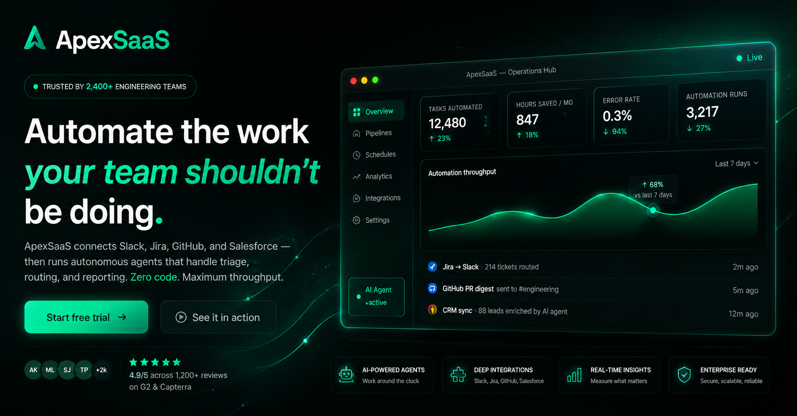

# ApexSaaS — Automation Intelligence Platform

> **Portfolio / demo project** built to showcase front-end skills.
> ApexSaaS is not a real company. All data, testimonials, company names,
> pricing, and metrics on the page are fictional.

**Live demo →** https://shevdevworks.github.io/apex-saas/



---

## Overview

A dark-themed ("Deep Obsidian & Emerald") SaaS landing page with an
animated hero, a bento feature grid, testimonials, and a fully
interactive pricing calculator — built with **zero frameworks and zero
build tooling**. Just semantic HTML, hand-written CSS, and vanilla JS,
with GSAP loaded from a CDN for animation.

The goal was to demonstrate production-quality front-end craft: a
token-driven design system, accessible interactive components, and
scroll-based motion — without reaching for React, Tailwind, or a
bundler.

---

## Features

- **Hero** — staggered GSAP load timeline (badge → headline → CTAs →
  dashboard), a floating dashboard mockup, animated KPI counters, and
  an SVG chart line that draws itself in on load
- **Bento feature grid** — 6-card CSS `grid-template-areas` layout,
  each card with its own micro-animation (pulse grid, sync bars, mini
  bar chart)
- **Testimonials** — 3-card layout with a featured/elevated center
  card and a scrolling logo strip
- **Pricing calculator** (fully vanilla JS, no libraries):
  - Custom-styled `<input type="range">` with an index-based model (7
    discrete steps) so the thumb snaps evenly to each tick label
  - Monthly / yearly billing toggle with live price recalculation
  - Auto-highlights the plan (Starter / Pro / Enterprise) that matches
    the selected user volume
  - Coverage bar on the Pro card showing how much of the selected
    volume it covers, with a warning state when volume exceeds the cap
- **Integrations grid** — 12 inline-SVG integration pills
- **Scroll animations** — GSAP ScrollTrigger; every section owns an
  independent timeline
- **Accessibility** — mobile nav drawer with focus management and
  Escape-to-close, `aria-live` regions on dynamic pricing values,
  keyboard-operable slider, and full `prefers-reduced-motion` support
  (all animations resolve to their end state instantly)
- **Resilient by design** — if the GSAP CDN fails to load or an
  animation errors out, a safety-net timeout force-reveals the page
  content instead of leaving it invisible

---

## Tech stack

| Layer | Tools |
|---|---|
| Markup | Semantic HTML5, BEM-style class naming |
| Styling | Hand-written CSS3 — design tokens via CSS custom properties, fluid `clamp()` type scale, 2-breakpoint responsive layout |
| Animation | [GSAP 3](https://gsap.com/) (core, ScrollTrigger, CustomEase) via CDN |
| Interactivity | Vanilla JavaScript (ES6+, IIFE modules — no bundler) |
| Typography | Space Grotesk · Inter · JetBrains Mono (Google Fonts) |
| Icons | Inline SVG (no icon library) |
| Hosting | GitHub Pages |

No npm dependencies at runtime, no build step — every asset is either
static or loaded from a CDN.

---

## Project structure

```
apex-saas/
├── index.html
├── css/
│   └── style.css       # design tokens + all component styles
├── js/
│   ├── app.js           # GSAP animation modules (hero timeline, counters, chart draw, scroll reveals)
│   └── script.js        # UI logic — nav, mobile menu, header scroll state, pricing calculator
└── images/
    ├── favicon.svg
    ├── favicon-32.png
    ├── favicon-16.png
    ├── apple-touch-icon.png
    └── og-image.png
```

---

## Running locally

No build step required — just serve the folder statically:

```bash
npx serve .
# or
python3 -m http.server 8080
```

Then open `http://localhost:8080` (or whatever port your server picks).

---

## Deploying to GitHub Pages

1. Push this folder to the `main` branch of the `apex-saas` repository
2. Go to **Settings → Pages → Source → Deploy from branch → `main` / root**
3. The site goes live at `https://<username>.github.io/apex-saas/` within a couple of minutes

---

*Built by [ShevDevWorks](https://github.com/shevdevworks) — demo project, open for freelance work.*
